<div align="center">

# 🩺 Self-Healing Data Pipeline

### *Autonomous Data Quality Engineering Powered by Grok (xAI)*

<p align="center">
  <a href="https://readme-typing-svg.demolab.com?font=Fira+Code&weight=600&size=22&pause=1000&color=6366F1&center=true&vCenter=true&width=650&lines=Autonomous+Data+Reliability+Agent;Powered+by+Grok+(xAI)+LLM+Diagnosis;Detects+Anomalies%2C+Synthesizes+Fixes+%26+Self-Heals;Conversational+CLI%3A+Type+'hi+dataset'+to+Begin;Sub-Second+In-Memory+DuckDB+Analytics">
    
  </a>
</p>

<p align="center">
  <strong>An enterprise-grade, closed-loop data pipeline that detects schema drift, corrupted formats, and data anomalies—then autonomously diagnoses root causes and heals the pipeline before downstream warehouses break.</strong>
</p>

<p align="center">
  <a href="https://github.com/girish-indurkar/self-healing-data-pipeline/actions/workflows/ci.yml">
    
  </a>
  <a href="https://github.com/girish-indurkar/self-healing-data-pipeline/blob/main/LICENSE">
    
  </a>
  <a href="https://www.python.org/downloads/">
    
  </a>
  <a href="https://x.ai/">
    
  </a>
  <a href="https://duckdb.org/">
    
  </a>
  <a href="https://streamlit.io/">
    
  </a>
</p>

</div>

---

## 📑 Table of Contents

- [🎯 Executive Summary](#-executive-summary)
- [✨ Key Features](#-features)
- [🏗️ System Architecture](#-architecture)
- [💬 Conversational CLI Experience](#-conversational-cli-experience)
  - [CLI Command Cheat-Sheet](#cli-command-cheat-sheet)
  - [Live Terminal Session Demonstration](#live-terminal-session-demonstration)
- [🛠️ Supported Self-Healing Actions](#-supported-self-healing-actions)
- [🛠️ Tech Stack](#-tech-stack)
- [⚡ Quick Setup](#-quick-setup)
  - [Prerequisites](#1-prerequisites)
  - [One-Command Setup (Windows & macOS/Linux)](#2-installation--virtual-environment)
  - [API Configuration](#3-configure-grok-xai-api-optional)
  - [Running the Project](#4-running-the-project)
  - [Verifying with Tests](#5-running-tests)
- [🐳 Docker Deployment](#-docker-deployment)
- [📁 Project Directory Structure](#-project-directory-structure)
- [🔐 Environment Variables](#-environment-variables)
- [🐍 Contribution Activity](#-contribution-activity)
- [❓ Frequently Asked Questions](#-faq)
- [📄 License](#-license)

---

## 🎯 Executive Summary

Data pipelines frequently break due to unexpected upstream alterations: **renamed columns, dirty currency strings, replayed batches with duplicate IDs, or unexpected nulls**. Traditional ETL systems crash, wake up on-call data engineers at 3 AM, and require hours of manual scripting to patch.

The **Self-Healing Data Pipeline** introduces an autonomous reliability agent that:
1. **Intercepts Failures:** Catches structured schema mismatches, type violations, nulls, and duplicate anomalies.
2. **Cognitive Root-Cause Diagnosis:** Leverages **Grok (xAI)** via fast LLM reasoning (with zero-dependency deterministic rule fallback) to deduce upstream causes.
3. **Guardrailed Auto-Remediation:** Safely auto-applies non-destructive fixes (`cast_type`, `rename_column`, `drop_duplicates`) while gating high-impact actions behind human approval.
4. **Resilient Warehouse Ingestion:** Validates the healed dataset and persists clean records into an embedded **DuckDB** data warehouse.

---

## ✨ Features

<table>
  <tr>
    <td width="33%" valign="top">
      <h3>🤖 Grok (xAI) Diagnosis</h3>
      <p>Uses high-speed reasoning from xAI's Grok model to parse error traces, evaluate sample records, and generate valid remediation plans.</p>
    </td>
    <td width="33%" valign="top">
      <h3>🔄 Closed-Loop Healing</h3>
      <p>Automatic retry loop: <code>Validate &rarr; Diagnose &rarr; Fix &rarr; Re-validate</code>. Repeats until data meets 100% compliance.</p>
    </td>
    <td width="33%" valign="top">
      <h3>🛡️ Dual Safety Guardrails</h3>
      <p>Whitelisted action taxonomy. Safe actions auto-apply instantly; risky operations (null drops, escalations) pause for human authorization.</p>
    </td>
  </tr>
  <tr>
    <td width="33%" valign="top">
      <h3>💬 Conversational CLI</h3>
      <p>Natural language interactive terminal. Type <code>"hi dataset"</code> to preview data and <code>"datapipeline"</code> to trigger healing.</p>
    </td>
    <td width="33%" valign="top">
      <h3>⚡ DuckDB Analytics</h3>
      <p>Blazing-fast columnar storage engine stores clean records with transactional guarantees and sub-second SQL queries.</p>
    </td>
    <td width="33%" valign="top">
      <h3>📊 Streamlit Web UI</h3>
      <p>Interactive web control center to inject synthetic upstream anomalies, trigger pipelines, and inspect real-time audit logs.</p>
    </td>
  </tr>
</table>

---

## 🏗️ Architecture

The pipeline processes data through a horizontal assembly line: **Ingestion &rarr; Validation Gate &rarr; Cognitive Engine &rarr; Safety Guardrails &rarr; Storage**.

```mermaid
flowchart LR
    subgraph INGESTION ["📥 Ingestion Layer"]
        CLI["💬 Terminal CLI<br/>('hi dataset' / 'datapipeline')"]
        UI["📊 Streamlit Web UI<br/>(Metrics & Injector)"]
        CSV["📄 Upstream CSV<br/>(orders.csv)"]
    end

    subgraph VALIDATION ["🔍 Quality Gate"]
        VAL{"⚖️ Schema & Type<br/>Validator"}
        ERR["⚠️ Structured Error<br/>(Schema / Type / Null / Dup)"]
    end

    subgraph COGNITIVE ["🧠 Cognitive Engine"]
        AGENT["🤖 Diagnosis Agent"]
        GROK["⚡ Grok (xAI) LLM<br/>(api.x.ai/v1)"]
        RULES["📏 Deterministic Rules<br/>(Zero-API Fallback)"]
    end

    subgraph SAFETY ["🛡️ Safety Gate"]
        GATE{"Action Policy"}
        AUTO["✅ Auto-Apply Fix<br/>(rename, cast, dedup)"]
        HUMAN["👤 Human Approval<br/>(nulls, drops, escalate)"]
    end

    subgraph STORAGE ["⚙️ Storage & Warehouse"]
        FIX["🛠️ Fix Applicator"]
        WAREHOUSE[("⚡ DuckDB Warehouse<br/>(warehouse.orders)")]
        LOGS[("📝 Audit Ledger<br/>(incidents.jsonl)")]
    end

    CLI --> CSV
    UI --> CSV
    CSV --> VAL
    VAL -- "Clean Data" --> WAREHOUSE
    VAL -- "Violations" --> ERR
    ERR --> AGENT
    AGENT --> GROK
    AGENT -.->|Fallback| RULES
    GROK --> GATE
    RULES --> GATE
    GATE -- "Safe Action" --> AUTO
    GATE -- "Risky Action" --> HUMAN
    AUTO --> FIX
    HUMAN -- "Approved" --> FIX
    FIX --> VAL
    FIX --> LOGS

    style INGESTION fill:#1E293B,stroke:#38BDF8,stroke-width:2px,color:#F8FAFC
    style VALIDATION fill:#1E293B,stroke:#F59E0B,stroke-width:2px,color:#F8FAFC
    style COGNITIVE fill:#1E293B,stroke:#818CF8,stroke-width:2px,color:#F8FAFC
    style SAFETY fill:#1E293B,stroke:#10B981,stroke-width:2px,color:#F8FAFC
    style STORAGE fill:#1E293B,stroke:#EC4899,stroke-width:2px,color:#F8FAFC
```



---

## 💬 Conversational CLI Experience

The pipeline provides a conversational terminal assistant powered by `rich`. Instead of memorizing cryptic flags, interact conversationally using everyday language.

### CLI Command Cheat-Sheet

| Phrase / Keyword | Action Triggered | Example Usage |
| :--- | :--- | :--- |
| **`hi dataset`** or **`load`** | Greets user, prompts for CSV file path, loads data, and prints a formatted 5-row preview | `🔧 Pipeline Agent: hi dataset` |
| **`datapipeline`** or **`heal`** | Launches the autonomous self-healing loop (Validate &rarr; Diagnose &rarr; Fix &rarr; Re-validate) | `🔧 Pipeline Agent: datapipeline` |
| **`schema`** | Renders expected target constraints (types, nullability, uniqueness) in a colorized table | `🔧 Pipeline Agent: schema` |
| **`status`** or **`report`** | Displays a structured summary card of the last executed healing session | `🔧 Pipeline Agent: report` |
| **`help`** | Prints interactive command reference and helpful pro-tips | `🔧 Pipeline Agent: help` |
| **`exit`** or **`quit`** | Gracefully terminates the REPL session | `🔧 Pipeline Agent: exit` |

---

### Live Terminal Session Demonstration

```text
╔═══════════════════════════════════════════════════════════════╗
║           🔧 Self-Healing Data Pipeline Agent 🔧              ║
║                                                               ║
║   Automatically detect and fix data quality issues            ║
║   Powered by Grok (xAI) + Rule-based Fallback                 ║
║   Type 'help' for commands or describe what you need!         ║
╚═══════════════════════════════════════════════════════════════╝

🔧 Pipeline Agent: hi dataset
👋 Hello! I'm your Self-Healing Pipeline Agent!
I can help you detect and fix data quality issues automatically.

📂 Enter CSV file path: tests/fixtures/dirty_types.csv
✅ Loaded: tests/fixtures/dirty_types.csv (5 rows × 4 columns)

          📊 Data Preview (first 5 rows)
  order_id   customer_name   amount    order_date
 ─────────────────────────────────────────────────
  1          Alice           $100.50   2024-01-15
  2          Bob             $200.00   2024-01-16
  3          Charlie         $50.75    2024-02-01
  4          Diana           $300.25   2024-02-14
  5          Eve             $75.00    2024-03-01

🔧 Pipeline Agent: datapipeline
┌─────────────────────────────────────────────────────────────────────────────┐
│ 🔧 Running self-healing on dirty_types.csv                                  │
└─────────────────────────────────────────────────────────────────────────────┘

🔄 Healing Attempt 1/3
Type mismatch in 'amount': expected float, found 5 bad samples
                             🔍 Validation Errors
┌───────────────┬─────────────────────────────────────────────────────────────┐
│ Type          │ Details                                                     │
├───────────────┼─────────────────────────────────────────────────────────────┤
│ type_mismatch │ column: amount, expected_type: float, bad_samples:          │
│               │ ['$100.50', '$200.00', '$50.75', '$300.25', '$75.00']      │
└───────────────┴─────────────────────────────────────────────────────────────┘

🤖 Diagnosing with Grok (xAI)...
🩺 Root Cause: 'amount' contains formatted strings like ['$100.50', '$200.00']
   Reasoning: Currency/formatting characters block numeric parsing.
   Source: llm:grok-3
   Confidence: 85%
   Proposed Fix: {'action': 'cast_type', 'column': 'amount', 'type': 'float'}

✅ Applied Fix: Cast column 'amount' to float
──────────────────────────────────────────────────
🔄 Healing Attempt 2/3
✅ All validations passed!

📝 Pipeline Status: SUCCESS (1 fix applied)
✨ Data is clean! Here's a preview:

          📊 Data Preview (Cleaned Data)
  order_id   customer_name   amount   order_date
 ────────────────────────────────────────────────
  1          Alice           100.5    2024-01-15
  2          Bob             200.0    2024-01-16
  3          Charlie         50.75    2024-02-01
  4          Diana           300.25   2024-02-14
  5          Eve             75.0     2024-03-01
```

---

## 🛠️ Supported Self-Healing Actions

| Action | Classification | Description | Execution Policy |
| :--- | :---: | :--- | :---: |
| `rename_column` | `SAFE` | Maps renamed upstream column names back to expected schema definitions | ✅ Auto-applied |
| `cast_type` | `SAFE` | Strips currency symbols (`$`, `€`), commas, whitespace, and casts to numeric/dates | ✅ Auto-applied |
| `drop_duplicates` | `SAFE` | Eliminates duplicated records generated by replayed upstream network batches | ✅ Auto-applied |
| `fill_nulls` | `RISKY` | Imputes missing values with calculated or default constants | ⚠️ Requires Approval |
| `drop_null_rows` | `RISKY` | Removes records with missing non-nullable attributes | ⚠️ Requires Approval |
| `escalate` | `CRITICAL` | Alerts human engineering team when ambiguity exceeds confidence thresholds | 🚨 Human Review |

---

## 🛠 Tech Stack

<div align="center">

| Domain | Technologies |
| :--- | :--- |
| **Language** |  |
| **AI / Reasoning** |   |
| **Warehouse & Data** |   |
| **Terminal & Web UI** |   |
| **Testing & CI/CD** |    |
| **Containerization** |  |

</div>

---

## ⚡ Quick Setup

Get up and running in under **2 minutes**.

### 1. Prerequisites
- **Python**: Version 3.10, 3.11, 3.12, or 3.13 installed
- **Git**: Installed and configured

---

### 2. Installation & Virtual Environment

#### On Windows (PowerShell):
```powershell
# 1. Clone repository
git clone https://github.com/girish-indurkar/self-healing-data-pipeline.git
cd self-healing-data-pipeline

# 2. Create and activate virtual environment
python -m venv venv
.\venv\Scripts\Activate.ps1

# 3. Install dependencies
pip install -r requirements.txt
pip install -e .
```

#### On Linux / macOS (Bash / Zsh):
```bash
# 1. Clone repository
git clone https://github.com/girish-indurkar/self-healing-data-pipeline.git
cd self-healing-data-pipeline

# 2. Create and activate virtual environment
python3 -m venv venv
source venv/bin/activate

# 3. Install dependencies
pip install -r requirements.txt
pip install -e .
```

---

### 3. Configure Grok (xAI) API (Optional)

The pipeline functions out of the box using an embedded **deterministic rule engine** without needing any API key. To activate Grok's deep cognitive reasoning:

```powershell
cp .env.example .env
```

Edit `.env` with your key from [console.x.ai](https://console.x.ai/):
```ini
XAI_API_KEY=your-xai-key-here
GROK_MODEL=grok-3
```

---

### 4. Running the Project

Choose your preferred interface:

#### Option A: Conversational Terminal CLI
```powershell
python -m self_healing_pipeline.interactive
# Try typing: "hi dataset" -> "tests/fixtures/dirty_types.csv" -> "datapipeline"
```

#### Option B: Real-Time Streamlit Web Dashboard
```powershell
streamlit run app.py
```
Open **[http://localhost:8501](http://localhost:8501)** in your browser to simulate pipeline errors, inspect DuckDB records, and watch live self-healing.

---

### 5. Running Tests

Verify all 31 unit, integration, and agent tests pass:

```powershell
# Windows
$env:PYTHONPATH="."
pytest tests/ -v

# Linux / macOS
PYTHONPATH=. pytest tests/ -v
```

Expected output:
```text
============================= 31 passed in 4.15s ==============================
```

---

## 🐳 Docker Deployment

Run the containerized self-healing agent without installing Python locally:

```bash
# Build the container
docker build -t self-healing-pipeline .

# Run interactive session
docker run -it --rm -e XAI_API_KEY="your-key" self-healing-pipeline
```

---

## 📁 Project Directory Structure

```text
self-healing-data-pipeline/
├── .github/
│   └── workflows/
│       ├── ci.yml              # CI/CD: Linting (Ruff), Multi-Python Tests (3.10-3.12)
│       └── snake.yml           # Daily scheduled contribution snake generator
├── agent/
│   ├── __init__.py             # Agent module interface
│   └── diagnose.py             # Grok (xAI) LLM diagnosis with rule-based fallback
├── pipeline/
│   ├── __init__.py             # Pipeline module exports
│   ├── etl.py                  # DuckDB ingestion & PipelineError definitions
│   ├── failure_injector.py     # Upstream anomaly generator (corruptions, renames)
│   ├── generate_data.py        # Synthetic dataset generator
│   └── runner.py               # Main iterative self-healing execution loop
├── tests/
│   ├── fixtures/               # Test datasets (clean, dirty types, duplicates, nulls)
│   ├── conftest.py             # Pytest fixtures and environment configuration
│   └── test_pipeline.py        # 31 unit & integration tests (100% pass rate)
├── .env.example                # Environment variables template
├── .gitignore                  # Git ignore rules for virtualenv, duckdb, and cache
├── Dockerfile                  # Container definition for containerized execution
├── requirements.txt            # Project dependencies manifest
├── setup.py                    # Package build and CLI entry points
├── app.py                      # Streamlit real-time interactive monitoring dashboard
├── apply_fix.py                # Remediation engine (renaming, casting, deduplication)
├── interactive.py              # Natural language interactive CLI
├── run.py                      # Orchestrator with human-in-the-loop approvals
├── validator.py                # Schema, type mismatch, null & duplicate validator
└── README.md                   # Project documentation
```

---

## 🔐 Environment Variables

| Variable | Required | Default | Description |
| :--- | :---: | :---: | :--- |
| `XAI_API_KEY` | Optional | `None` | xAI API key from [console.x.ai](https://console.x.ai/). If omitted, rule-based fallback activates. |
| `GROK_MODEL` | Optional | `grok-3` | Model identifier to use (`grok-3`, `grok-2`, `grok-beta`). |
| `LOG_LEVEL` | Optional | `WARNING` | Logging verbosity (`DEBUG`, `INFO`, `WARNING`, `ERROR`). |

---

## 🐍 Contribution Activity

<div align="center">

<picture>
  <source media="(prefers-color-scheme: dark)" srcset="https://raw.githubusercontent.com/girish-indurkar/self-healing-data-pipeline/output/github-contribution-grid-snake-dark.svg">
  <source media="(prefers-color-scheme: light)" srcset="https://raw.githubusercontent.com/girish-indurkar/self-healing-data-pipeline/output/github-contribution-grid-snake.svg">
  
</picture>

</div>

---

## ❓ Frequently Asked Questions

<details>
<summary><strong>1. Does the pipeline require an active Grok (xAI) API key to run?</strong></summary>
<br/>
<strong>No.</strong> The system is architected with dual diagnosis backends. If <code>XAI_API_KEY</code> is not provided, the pipeline seamlessly engages its deterministic rule-based engine. It can run in air-gapped or offline environments while achieving full test suite pass rates.
</details>

<details>
<summary><strong>2. How does the pipeline prevent destructive data modifications?</strong></summary>
<br/>
Every proposed remediation is filtered through an action policy controller. Operations that alter or drop records (e.g. <code>fill_nulls</code>, <code>drop_null_rows</code>) are flagged as <code>RISKY</code> and pause for interactive user confirmation. Non-destructive operations (such as column renames and type parsing) are classified as <code>SAFE</code> and apply automatically.
</details>

<details>
<summary><strong>3. Can I connect this to PostgreSQL, Snowflake, or BigQuery instead of DuckDB?</strong></summary>
<br/>
<strong>Yes.</strong> The validation and fix engines operate directly on <code>pandas.DataFrame</code> objects. Replacing the DuckDB connector in <code>pipeline/etl.py</code> with SQLAlchemy, Snowflake-connector, or BigQuery Client allows seamless integration into any warehouse architecture.
</details>

<details>
<summary><strong>4. How does the conversational CLI handle unexpected prompts?</strong></summary>
<br/>
The CLI tokenizes user inputs and maps them to semantic intent clusters (e.g. greetings, loading, healing, inspection, help). If an unrecognized prompt is entered, it gracefully surfaces available commands with interactive tips rather than crashing.
</details>

---

## 📄 License

Distributed under the **MIT License**. See [`LICENSE`](LICENSE) for details.

---

<div align="center">
  <sub>Built with precision by <a href="https://github.com/girish-indurkar"><strong>Girish Indurkar</strong></a>. If this project helped you, consider starring ⭐ the repository!</sub>
</div>
